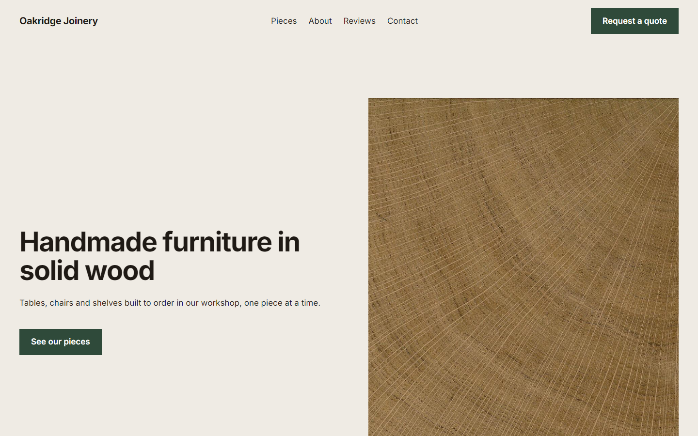
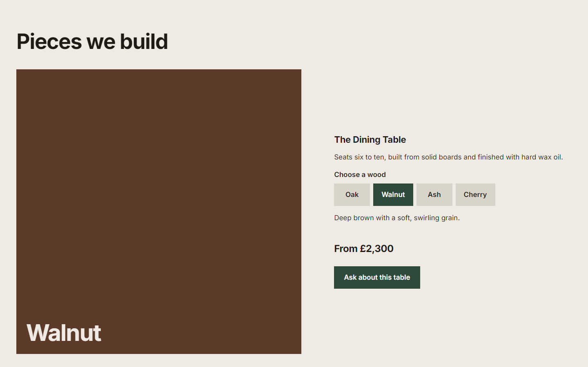
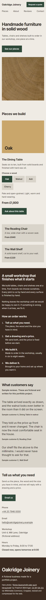

# Oakridge Joinery

A responsive website for a **fictional** furniture workshop, built with plain HTML, CSS and JavaScript. It is a portfolio project: the business, prices, reviews, address and phone number are all made up.

**Live site:** https://Mustypro137.github.io/modern-business-website/ <!-- works once GitHub Pages is switched on -->



## What it does

- **Choose a wood.** The dining table section lets you pick oak, walnut or ash (or cherry) and see the colour, description and price change. It is built from real radio buttons, so it works with the keyboard and screen readers.
- **"Open now" status.** The contact section says whether the workshop is open, using London time, so a visitor in another country still sees the right answer.
- **Works without JavaScript.** If the script fails, the woods appear as a plain list and nothing is broken.
- **Responsive.** Laid out for phone, tablet and desktop. The navigation links wrap onto a second row on phones, so no hamburger menu is needed.
- **Contact without a backend.** A `mailto:` link opens an email with the subject and body already filled in.

| Wood picker (desktop) | Phone |
|---|---|
|  |  |

## Built with

HTML, CSS and vanilla JavaScript. No framework, no build step, no dependencies. The only external resource is the Inter font from Google Fonts.

## Run it locally

Download or clone the project and open `index.html` in a browser. There is nothing to install.

## Project structure

```
index.html          the page
css/style.css       design tokens (colours, type, spacing) and all styles
js/main.js          the wood picker and the open-now status
images/             the hero photo and credits.json
screenshots/        images used in this README
```

## Design decisions

- **Colours come from the materials.** A pale ash background, dark walnut text and sections, and one workshop green used only for buttons. Sections are separated by changes in background colour, not by lines or shadows.
- **One typeface (Inter),** with large headings and plain body text.
- **No photo of furniture.** Free image libraries had no honest photographs of finished pieces, so the hero is a close-up of an oak trunk (the material itself), and each wood is shown as a flat colour.
- **Everything is defined once.** Colours, sizes and spacing are CSS variables at the top of `style.css`.
- **The list of woods lives in the HTML once.** The script reads it and builds the picker, so there is no second copy to keep in sync.

## What was tested

Checked in Chrome (desktop browser, with the viewport resized to each width):

- No console errors, no failed requests, no broken links or images.
- No sideways scrolling and no headline longer than two lines at widths from 320px to 1440px.
- Text contrast measured on every text element: all pass WCAG AA (lowest ratio 6.5:1).
- Keyboard: every link and control can be reached with Tab and shows a visible focus outline. The arrow keys work in the wood picker.
- The page still works with JavaScript switched off, and it respects "reduce motion".
- The open-now logic was run against 11 fake clock times, including opening and closing time, weekends and summer/winter time.

**Not tested:** Firefox, Safari, real phones, screen readers.

## Sample content

These are placeholders and are not real business information:

- The business name, address (`Unit 4, Mill Lane, Oakridge`), phone number and email (`.example` addresses cannot receive mail).
- All prices, the "six to eight weeks" lead time and the opening hours.
- The three customer reviews. They are fictional and labelled as such on the page.

## Credits

- Hero photo: ["Eiche Querschnitt oder auch Hirnschnitt"](https://commons.wikimedia.org/wiki/File:Eiche_Querschnitt_oder_auch_Hirnschnitt.jpg) by Friedrich Böhringer, [CC BY-SA 3.0](https://creativecommons.org/licenses/by-sa/3.0/at/deed.en), via Wikimedia Commons. Cropped, resized and compressed for the web. It is a stand-in and should be replaced with photographs of real work.
- Font: [Inter](https://rsms.me/inter/), loaded from Google Fonts.

## What I learned

<!-- Write this section yourself, in your own words. Two or three short points are enough. For example: what was hardest, one bug you found, one thing you would do differently. -->

## Possible improvements

- Replace the stand-in photo with real photographs of finished pieces.
- Test in Firefox and Safari, and with a screen reader.
